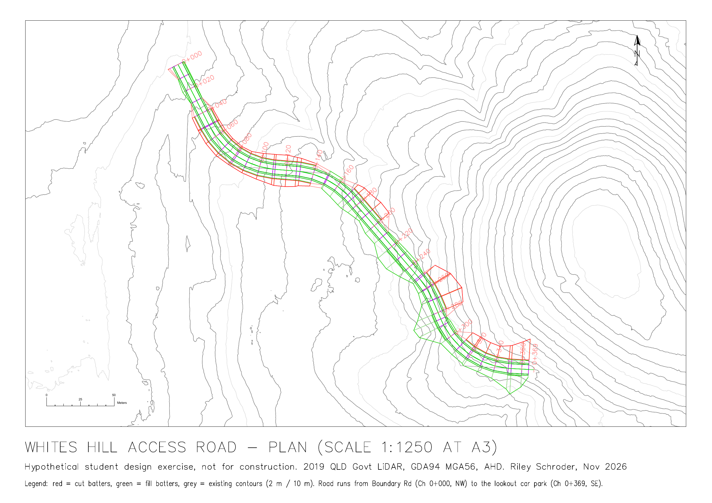

# Whites Hill Access Road

A self-directed student project: a hypothetical 369 m access road designed in Civil 3D over real LiDAR terrain at Whites Hill Reserve, Camp Hill, Brisbane, with an independent earthworks check, a cost estimate and a construction programme.



Drawings: [plan](drawings/WH_01_Plan_v3.pdf) · [long section](drawings/WH_02_Long_Section_v3.pdf) · [cross sections](drawings/WH_03_Cross_Sections_v3.pdf) · Estimate: [cost estimate and programme (.xlsx)](estimate/whites-hill-estimate.xlsx)

## What this is

My first Civil 3D project, done over the 2026–27 summer break after first year. The road is hypothetical: a sealed two-lane access road from Boundary Road up to a lookout car park and trailhead on the south-west shoulder of Whites Hill. It is on reserve land, so it is not a real proposal. The aim was to take one road from terrain data through alignment, profile, corridor and volumes to a priced estimate and a programme, and to check my own model independently.

Status, November 2026: design v3 is final; drawings, earthworks check, estimate and programme are done.

## Design brief

| Item | Value |
|---|---|
| Purpose | Access from Boundary Road to a lookout car park / trailhead; walkers continue on the existing track to the 112 m summit |
| Design speed | 40 km/h |
| Length | 369 m (design v3) |
| Cross-section | 2 × 3.5 m lanes, 1.0 m shoulders (9 m formation), −3% crossfall, table drains both sides (2.0 m foreslope at 4:1 plus a 0.5 m ditch), 2:1 cut and 3:1 fill batters |
| Pavement | 0.667 m total depth below finished level, lanes and shoulders (layer split not designed) |
| Horizontal curves | 4 PIs, 60 m radius curves |
| Vertical profile | +10.0% to Ch 0+345, 30 m crest curve (K 4.6), then +3.45% to the car park |
| Design vehicle | Not set (cars and occasional service vehicles assumed) |

## What I did

1. **Terrain.** Downloaded four 1 km tiles of the Queensland Government's 2019 1 m LiDAR DEM from ELVIS and built an existing-ground surface in Civil 3D (4 million points, 20.3–111.9 m AHD). Found the data was GDA94 / MGA Zone 56, not GDA2020 as I first assumed, and set the drawing to match.
2. **Alignment.** My first route ran through houses on Ara, Pavo and Indus Streets; I only saw it once I checked against aerial imagery. I moved the road to follow an existing track up the hill, reusing a corridor that is already disturbed to cut clearing and earthworks. Curves cut off the track's tighter bends, so walkers would need a separate path.
3. **Profile.** Drew the vertical profile with parabolic curves. An early version squeezed the crest curve to 13 m (K 2.7) because the last PVI was only 7 m from the end; I moved it back to give a 30 m curve.
4. **Corridor.** Built the assembly from the ANZ TMR Queensland subassemblies (Civil 3D ANZ Country Kit 2027) and daylit the batters to the existing ground.
5. **Independent earthworks check.** Wrote a Python calculator, later ported to MATLAB ([earthworks-calculator](https://github.com/rileyschroderstudent-oss/earthworks-calculator)), and compared it with Civil 3D section by section. It showed my corridor had no shoulder or table drain on the right side. The totals had looked plausible. Fixing it raised cut by 20%.
6. **Reducing the surplus.** The design was cut-heavy. I raised the grade line and narrowed the table drains (v3), cutting the surplus by 64% (9,425 → 3,404 m³). Balancing cut and fill fully would need a 10.26% grade, over the 10% limit I set, so v3 still has a surplus.
7. **Cost estimate and programme.** Priced the v3 quantities and laid the build out as a 13-activity programme with a Gantt chart.

## Tools and data

- Autodesk Civil 3D 2027 (education licence), ANZ Country Kit 2027
- Python 3.13 (pandas, NumPy, Matplotlib) and MATLAB R2026b for the earthworks check
- Terrain: Queensland LiDAR Data – Brisbane 2019 Project, 1 m DEM, from [ELVIS](https://elevation.fsdf.org.au/). © State of Queensland (Department of Resources) 2023, [CC BY 4.0](https://creativecommons.org/licenses/by/4.0/). GDA94 / MGA Zone 56, heights in AHD.
- Standards: **not checked against a design standard.** The 10% grade limit is my own. Civil 3D's design checks used the default AASHTO 2011 criteria; a real Queensland job would check against Austroads, TMR's Road Planning and Design Manual and Brisbane City Council requirements.

## Results

**Earthworks (Civil 3D TIN volume surface, rebuilt corridor, Ch 0+000 to 0+365, factors 1.0)**

| | Volume |
|---|---:|
| Cut | 5,162 m³ |
| Fill | 1,758 m³ |
| Surplus to cart away | 3,404 m³ |

The calculator matched Civil 3D's cut area at all 19 sample stations (5,385 m³ summed by average end area; the TIN gives about 4% less because it integrates continuously).

**Cost estimate (concept stage, 2026 rates, excl. GST)**

| | Amount |
|---|---:|
| Direct works | $919,798 |
| Preliminaries (12%) | $110,376 |
| Design, survey and project management (10%) | $103,017 |
| Contingency (30%) | $339,957 |
| **Total (rounded)** | **about $1.47M** (about $4,000 per metre) |

At concept stage the realistic range is about $1.2M to $2.2M (−20% / +50%). Most rates are assumptions, labelled as such in the estimate; the published sources are BITRE Research Report 148 (earthworks, escalated from 2017 to 2026 using the Queensland road and bridge construction price index), a 2024 Charters Towers Regional Council estimate (clearing, topsoil, culvert pipe) and council landfill fees. Two sensitivities matter more than any single rate:

- **Where the spoil goes.** If a nearby site takes clean fill free, the total drops to about $1.36M; if it all goes to council landfill at $136/t, it rises to about $2.73M. That is the real cost of the surplus the grade limit forces.
- **Pavement depth.** The modelled 0.62 m of granular pavement is deep for a low-traffic road. A typical light-traffic pavement of about 0.35 m (an assumption, not a design) would bring the total to about $1.30M.

**Programme:** 53 working days (11 weeks), including a 20% wet-weather allowance. Bulk earthworks and pavement are the critical path. Durations come from assumed daily outputs, not published rates.

## Limitations

- Student exercise. Not reviewed by a registered engineer. Not for construction.
- Not checked against Austroads, TMR or Brisbane City Council criteria (grades, curve radii, sight distance). The crest curve's K 4.6 has not been checked for stopping sight distance.
- No geotechnical data: batter slopes are assumed, and rock or unsuitable material is not allowed for. Pavement depth is not designed for traffic loading.
- No drainage design: culverts and drain lining are priced as allowances, and the table drains' capacity on a 10% grade is not checked.
- The car park / turning head and the walkers' path are not designed.
- No survey, services, environmental or approvals assessment. The site is a council reserve.
- Cost rates are indicative and mostly assumed; no escalation applied.

## What I learned / would change

- Check the route against aerial imagery before designing anything.
- Plausible totals can hide a modelling mistake. Comparing section by section found a missing shoulder and drain that the totals didn't show.
- The grade limit and the earthworks balance pull against each other on this site; next time I'd set the criteria first and test alignments against both before committing to one.
- Spoil disposal can matter more than any single rate. I'd find out where surplus fill could go before deciding how much surplus is acceptable.

## How it was made

Built with help from Claude (Anthropic): it walked me through each Civil 3D session alongside Autodesk's short course units, wrote parts of the earthworks calculator (see that repo's README), and drafted this write-up. Claude drafted the cost estimate and programme; I reviewed the rates and assumptions, pushed for the fixes (rounding, escalation, pavement sensitivity) and can explain each line. I chose the site and route, made the design decisions, built and fixed the Civil 3D model, and checked the outputs.

## Files

```
drawings/   plan, long section and cross-section sheets (A3 PDF)
images/     plan sheet preview
estimate/   cost estimate and programme (.xlsx)
```

The Civil 3D drawing (WH_Surface.dwg) and the DEM tiles are not in this repo: the .dwg is a large binary file, and the DEM is available from ELVIS. The earthworks check is in its own repo: [earthworks-calculator](https://github.com/rileyschroderstudent-oss/earthworks-calculator).

## Licence and contact

Text, drawings and images: [CC BY 4.0](https://creativecommons.org/licenses/by/4.0/). Terrain-derived data: CC BY 4.0, © State of Queensland (Department of Resources) 2023.
Riley Schroder, civil engineering / commerce student, University of Queensland. [LinkedIn](https://www.linkedin.com/in/riley-schroder/)
